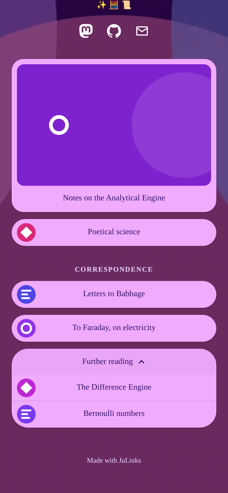
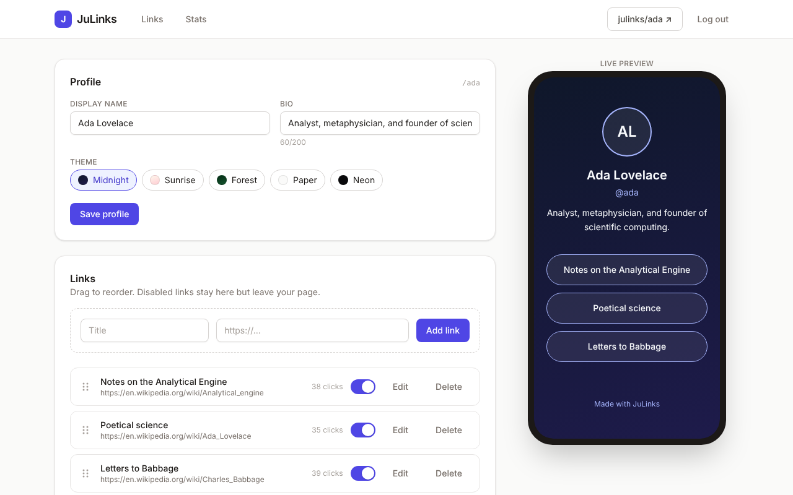
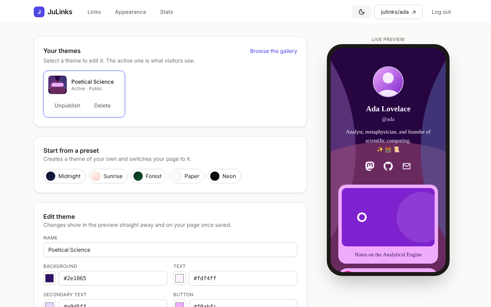
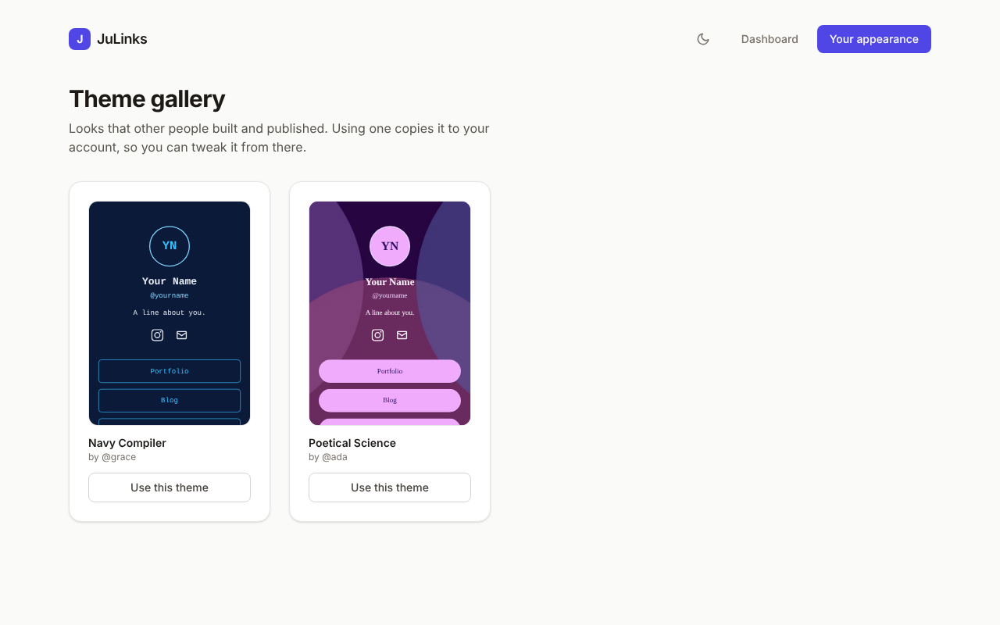
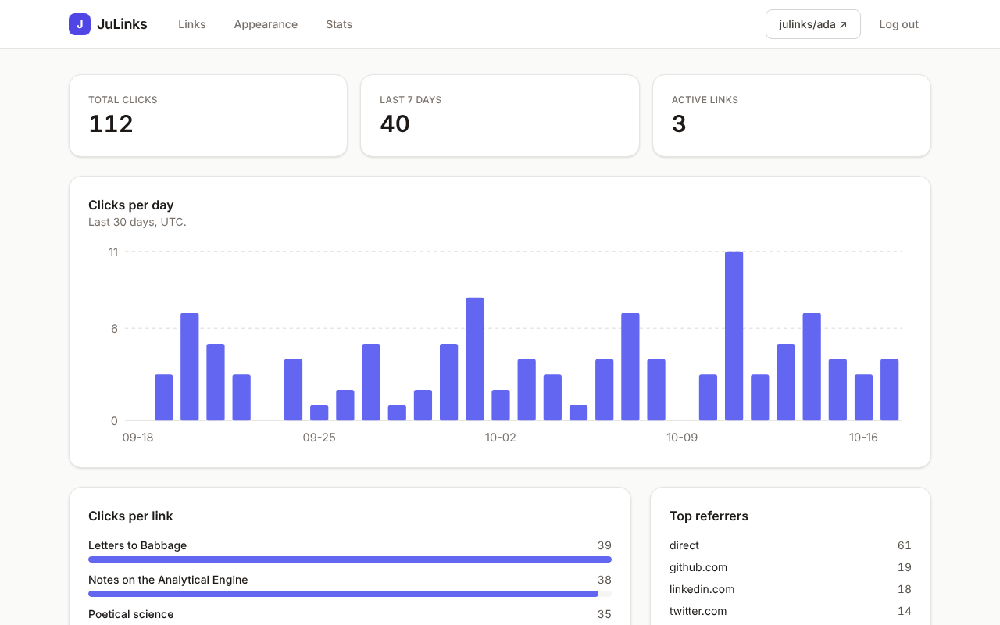
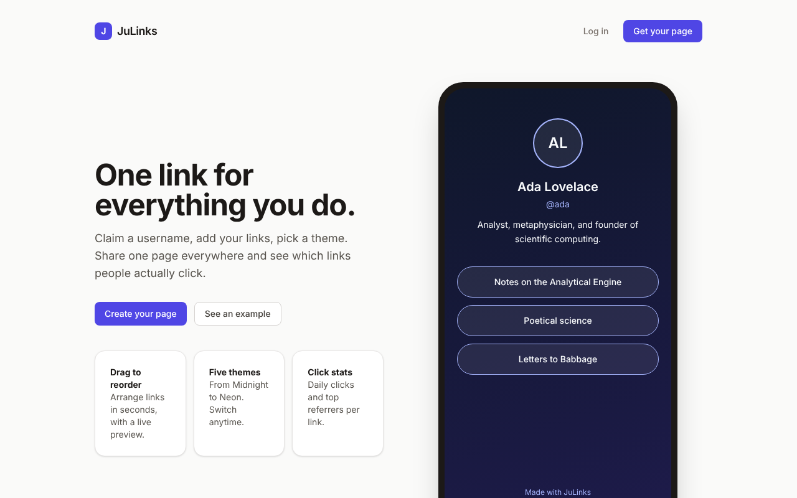
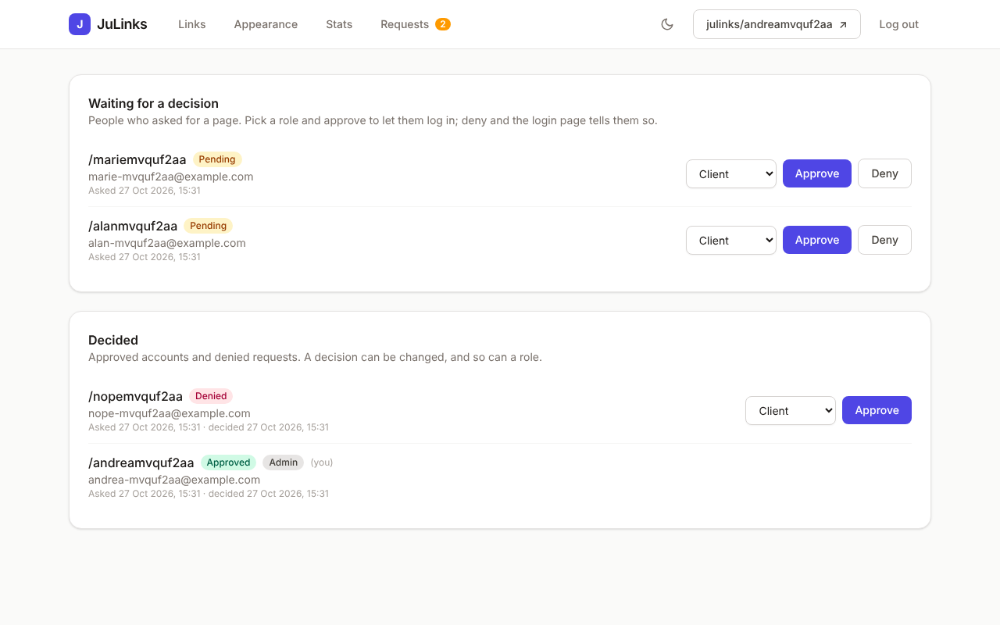
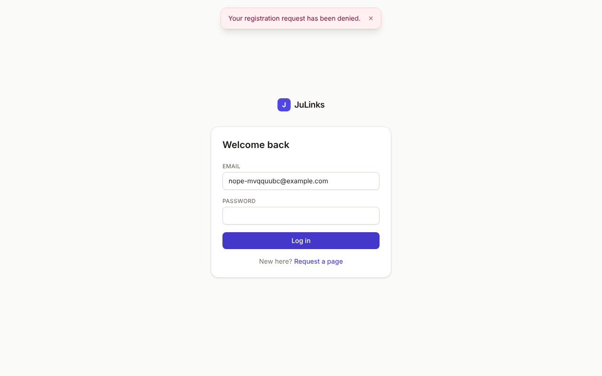
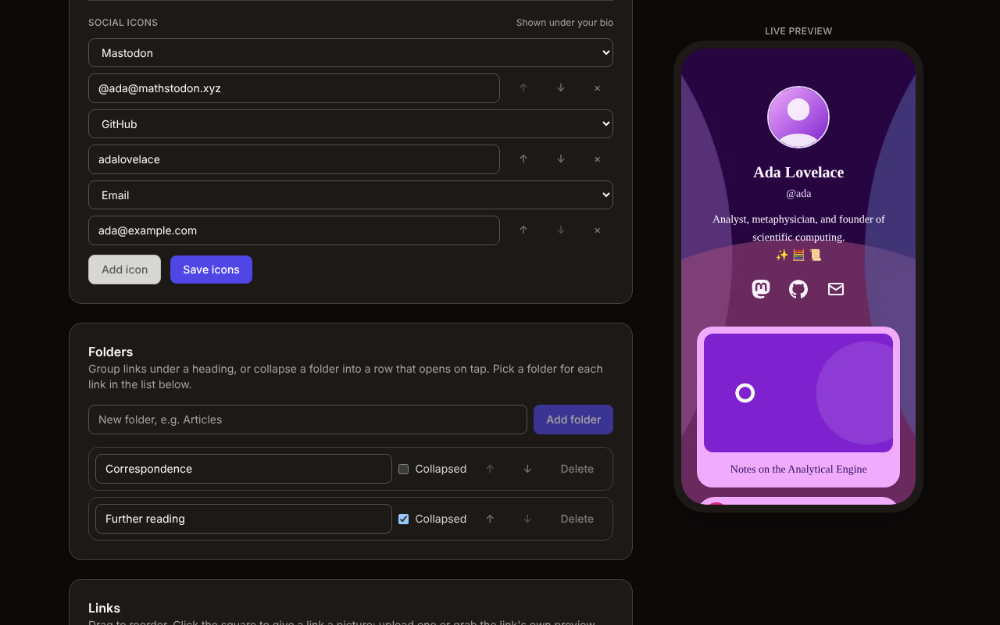

# JuLinks

[](https://github.com/adev0x3b/julinks/actions/workflows/ci.yml)
[](LICENSE)
[](https://nextjs.org)

## About

Hello! My name is Andrea Cracchiolo. JuLinks is born because my wife wanted a linktree she could customize as she wished; I built it with [Claude Code](https://claude.com/claude-code) as a pair programmer and reviewed every change. MIT licensed, see [LICENSE](LICENSE).

Live at [links.juume.site](https://links.juume.site).

<p align="center">
  
  
</p>



<details>
<summary>More screenshots</summary>

| Theme studio | Theme gallery |
| --- | --- |
|  |  |

| Stats | Landing page |
| --- | --- |
|  |  |

| Sign-up requests | Denied at login |
| --- | --- |
|  |  |



</details>

## Features

- **Links** with drag-and-drop ordering, on/off switches and a live phone-sized preview.
- **Pictures** for links and the avatar: upload one, or grab the link's own `og:image` (or, failing that, the site's icon). Pick the focal point and zoom in up to 3×, show it small beside the title or big like a card.
- **Folders**, open as a headed section or collapsed as a row that expands on tap.
- **Bio and social icons** for 24 platforms. Type a handle, the app builds the URL.
- **Themes**: five presets, every colour, gradient, button style, radius and font adjustable, a background image with overlay. Publish a theme to the gallery and anyone can copy it.
- **Stats**: totals, a 30-day chart, clicks per link, top referrers.
- **Invite only**: a sign-up is a request that an admin or moderator approves, with a role, or denies. With mail set up, the requester confirms their email first, the admins get an email about new requests and the requester one about the decision.
- **Password reset** by mail, with a one-use link.
- **First-run setup**: a fresh install serves nothing until the admin account is created with a one-time code printed by `docker compose up`.
- **Dark mode** in the dashboard. Public pages take every colour from their theme.

## Quick start

```bash
git clone https://github.com/adev0x3b/julinks.git && cd julinks
cp .env.example .env
docker compose up --build
```

The first start prints a **setup code**. Open <http://localhost:3000/setup>, enter it and create the admin account. From then on the site is live.

- Demo pages: [/ada](http://localhost:3000/ada), [/grace](http://localhost:3000/grace), gallery at [/themes](http://localhost:3000/themes).
- Demo login: `ada@example.com` / `analytical-engine`.
- Lost the code? `docker compose run --rm --no-deps migrate npm run setup-code` prints a new one. Five wrong guesses void a code too.

The stack is PostgreSQL, SeaweedFS (S3 API) for images, a one-shot `migrate` container (migrations and demo data) and the app on port 3000, published on `127.0.0.1` only. Migrations are additive, so `git pull && docker compose up --build -d` is the whole upgrade.

## Configuration

Everything is read from `.env` (see [`.env.example`](.env.example) for the comments).

| Variable | Default | What it does |
| --- | --- | --- |
| `SESSION_SECRET` | placeholder | Signs session cookies. The placeholder only works on localhost; use `openssl rand -base64 48`. |
| `APP_URL` | `http://localhost:3000` | Public address, used for absolute URLs and the secret check above. The build reads it too (link previews), so change it with `--build`. |
| `WEB_PORT`, `WEB_BIND` | `3000`, `127.0.0.1` | Where compose publishes the app. `WEB_BIND=0.0.0.0` opens it to the LAN. |
| `TRUST_PROXY` | unset | `cloudflare` behind a Cloudflare Tunnel, `1` behind nginx, Caddy or Traefik: keys rate limits on the visitor's address. |
| `ALLOW_DEMO_LOGIN` | `1` | Set `0` on a public site so nobody logs in as the demo profiles. |
| `S3_*` | the compose SeaweedFS | Any S3-compatible service works, AWS S3 and Cloudflare R2 included. |
| `SMTP_HOST`, `SMTP_PORT`, `SMTP_USER`, `SMTP_PASSWORD`, `MAIL_FROM` | unset, `587` | Mail through any SMTP server with STARTTLS. Unset means no mail; the app logs what it would have sent. |
| `MAIL_DAILY_LIMIT`, `MAIL_HOURLY_LIMIT` | `50`, `10` | Addresses the app may mail per rolling 24 hours and hour. Keep them under your provider's quota. |

### Mail

Every mail goes into an outbox table first, and the app sends from it once a minute while the daily and hourly budget allows. What does not fit waits there, through restarts, until it does; admins see the queue, the day's count and anything that failed at the bottom of the Requests page, and can delete a waiting mail before it goes out.

- The admins get one email when a sign-up request arrives. Only one notice waits at a time, half an hour apart, and it lists the requests waiting when it goes out, so a burst of requests costs two messages.
- A requester gets one when their request is approved or declined, or their account closed. **Spam** on the Requests page declines without a mail, since junk sign-ups tend to use made-up addresses that bounce.
- A temporary refusal is retried with growing gaps; a bounced address is marked failed and not retried. Nothing about mail ever blocks a sign-up or a review.
- A sign-up first mails a confirmation link; only using it puts the request in front of the admins. An address that already has an account gets a mail saying so instead, and the form answers the same either way, so it never tells who is registered. One confirmation per address an hour, one "already exists" a day, 20 sign-up mails a day for the whole site.
- At most 20 new requests a day are taken, from every address together, so a botnet cannot fill the review queue.
- **Forgot password?** on the login page mails a link that works once, for 30 minutes. One open link per account and three a day, five requests an hour per IP, twenty a day for the whole site. These go out ahead of everything else and are dropped if they cannot go out within 15 minutes. Without mail the page says to ask an admin.

If the relay runs in another compose project on the same machine, [`docker-compose.mail.yml`](docker-compose.mail.yml) joins its Docker network; turn it on with `COMPOSE_FILE` in `.env` (see [`.env.example`](.env.example)).

### Exposing it to the internet

1. Set a real `SESSION_SECRET`, `APP_URL` with `https://`, `TRUST_PROXY` for your proxy and `ALLOW_DEMO_LOGIN=0`.
2. Put TLS in front: a Cloudflare Tunnel, Caddy or nginx on the same machine pointing at `http://localhost:3000`.
3. Complete `/setup` before sharing the address.

Then `docker compose up --build -d`. The services restart with Docker, so a reboot brings the site back on its own. The security details behind these steps are in [docs/security.md](docs/security.md).

## Development

```bash
cp .env.example .env
docker compose up -d db s3      # PostgreSQL and SeaweedFS, or bring your own
npm install
npx prisma migrate dev
npm run db:seed                 # demo profiles, optional
npm run dev
```

Without Docker, `npx tsx scripts/fake-s3.ts 3101` is an in-memory S3 stand-in; point `S3_ENDPOINT` at it.

Built with Next.js 16 (App Router, Cache Components, Server Actions), React 19, TypeScript, Tailwind, Prisma 7 and PostgreSQL 16; images go through `sharp` into an S3 bucket. [docs/architecture.md](docs/architecture.md) walks through the code.

## Tests

| Command | Runs | Needs |
| --- | --- | --- |
| `npm test` | Unit and component tests | nothing |
| `npm run test:integration` | The data layer against a real database and bucket | PostgreSQL (`TEST_DATABASE_URL`); the S3 stand-in starts itself |
| `npm run test:e2e` | Playwright against a production build | PostgreSQL (`E2E_DATABASE_URL`), `npm run build` first |

CI runs lint, types, the three suites and a smoke test of the real compose stack, setup code included.

## Security

- bcrypt passwords, signed `httpOnly` cookies, a session version that logs other devices out on password change.
- Every write goes through a Server Action that verifies the session and scopes the query to the owner.
- Rate limits per IP and per account on login, per IP on sign-up and clicks, per user on uploads.
- Uploads are sniffed, capped at 5 MB and re-encoded to WebP; only the PNG, JPEG, WebP and GIF decoders are enabled.
- Fetching a link's preview image is guarded against SSRF: public addresses only, checked at DNS and socket level, every redirect hop included.
- A strict CSP, HSTS and the usual headers on every response. Weekly Dependabot.

More in [docs/security.md](docs/security.md).

## Limits

- The rate limiter and the page cache live in process memory, which fits one container. Several replicas would need Redis and a shared cache handler.
- No email verification: sign-up addresses are trusted until an admin approves them.
- Images are streamed through the app, not from a CDN.

## Contributing

1. Fork the repository and create a branch named after the change (`feature/scheduled-links`, `fix/folder-drag`).
2. Keep `npm run lint`, `npm run typecheck` and `npm test` green, and add a test where the change needs one. The integration and e2e suites run in CI on every pull request.
3. Open a pull request against `main` and say what it does and why. I will try to review the PR as soon as possible. My wife has the last say-so on new features.

Bug reports and ideas are welcome as issues.
